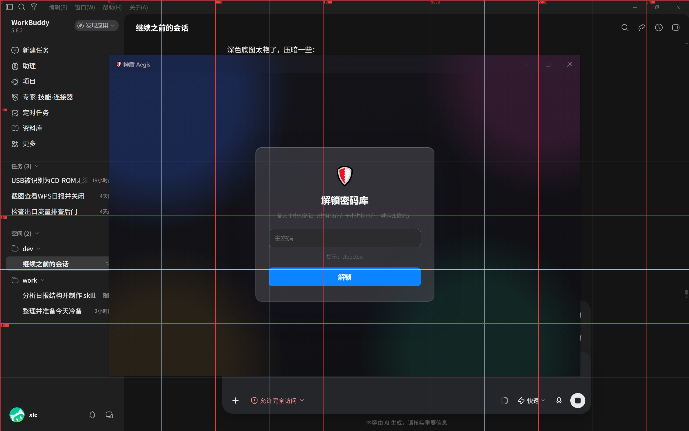
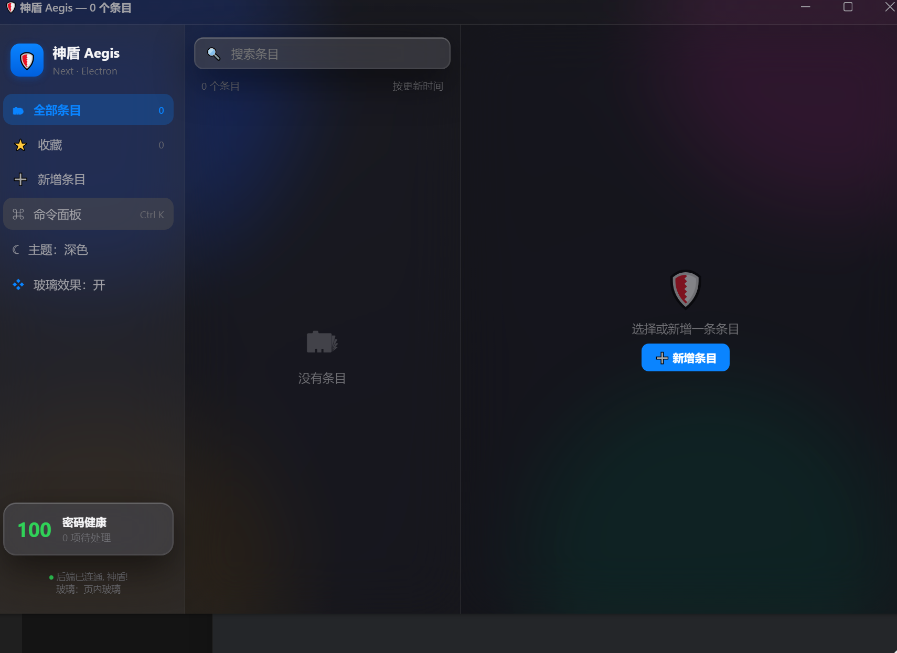
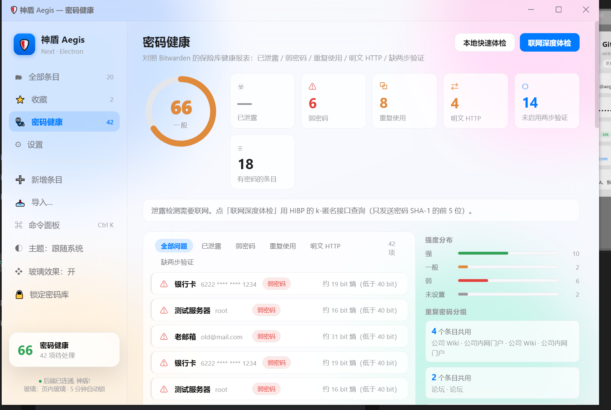
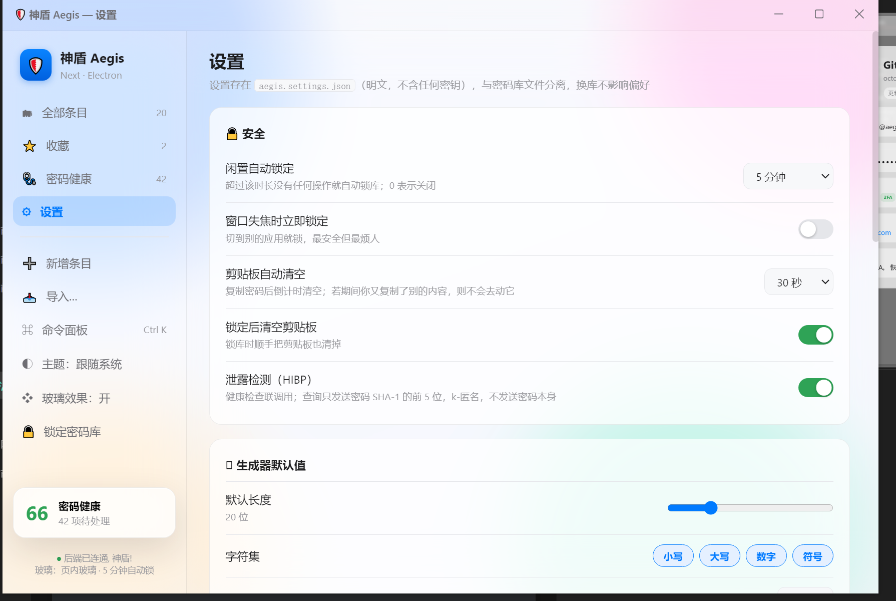

# 神盾 Aegis

**本地优先、零知识加密的开源密码管理器** —— 桌面版（Electron + React + TypeScript）


密码只存在你自己的机器上：主密码经 Argon2id 派生出密钥，用它包裹一把随机数据密钥（DEK），
每个条目再用 DEK 独立做 AES-256-GCM 加密。**没有账号、没有云端、没有遥测**，
断网也能完整使用。

> ### ⚠️ 非官方关联声明
>
> 本项目与 **1Password、Bitwarden、KeePass、LastPass、Dashlane、Aegis Authenticator** 等
> 任何第三方产品**均无任何关联**，未获其授权、赞助或背书。文档中提及这些名称**仅用于
> 客观的功能对比或数据格式兼容性说明**（例如"可以从 Bitwarden 的 CSV 导出导入"），
> 不构成任何形式的合作或认可关系。上述产品名称与商标归其各自所有者。
>
> 本项目的界面与代码均为**独立实现**，未复制任何第三方项目的源代码或美术资源。

---

## 目录

- [这是什么](#这是什么)
- [功能一览](#功能一览)
- [截图](#截图)
- [安全设计](#安全设计)
- [下载安装](#下载安装)
- [从源码构建](#从源码构建)
- [开发、测试与验证](#开发测试与验证)
- [目录结构](#目录结构)
- [发布与自动更新](#发布与自动更新)
- [隐私](#隐私)
- [安全漏洞上报](#安全漏洞上报)
- [贡献](#贡献)
- [第三方组件与许可](#第三方组件与许可)
- [许可证](#许可证)

## 这是什么

一个跑在本地桌面上的密码管理器：

- **零知识** —— 主密码不出本机，密钥只存在于解锁期间的进程内存里，锁定即擦除。
- **信封加密** —— 改主密码时只重新包裹那把 DEK，条目密文一条都不动，因此改密码零风险。
- **纯本地** —— 密码库就是磁盘上的一个 JSON 文件，你可以自己备份、自己同步。

**它不是什么**（先说清楚，省得你白装）：

| 不做的事 | 原因 |
|---|---|
| 云同步 / 多设备自动同步 | 需要服务端，与本项目"纯本地"的定位冲突 |
| 浏览器扩展、iOS / Android 客户端 | 当前只做桌面端。Android **不是"加个 CI job"能解决的** —— Electron 没有 Android 目标，需要重做移动端布局，并把加密核心从主进程搬到 WebView。方案评估见 [docs/BUILD-PLATFORMS.md](docs/BUILD-PLATFORMS.md) |
| 团队共享、审计日志 | 面向个人使用 |
| 找回主密码 | 零知识加密在数学上没有后门，忘了只能重置（会保留旧库备份） |
| 静默自动更新 | 密码管理器不该在用户不知情时替换自己的可执行文件（详见[发布与自动更新](#发布与自动更新)） |

> **已知状态：本项目尚未经过第三方独立安全审计。** 加密方案用的是公开标准的算法与参数
> （Argon2id + AES-256-GCM，与应用层协议直接调用），但"设计正确"不等于"实现无缺陷"。
> 请自行评估风险；重要凭据建议同时保留一份离线备份。

## 功能一览

| 模块 | 说明 |
|---|---|
| **密码库** | Argon2id（m=64 MiB, t=3, p=4）→ KEK → 包裹随机 DEK → AES-256-GCM 信封加密，AAD = `{条目id}\|{类型}` |
| **三栏界面** | 分组 / 列表 / 详情；自绘标题栏；明暗主题 + 液态玻璃三层降级（原生材质 → 自绘 → 关） |
| **密码生成器** | 参数化随机密码 + 中文词组口令，长度/字符集约束硬校验 |
| **TOTP** | RFC 6238 两步验证码，环形倒计时 |
| **命令面板** | `Ctrl/Cmd + K` 全局搜索与动作 |
| **快速填充（Auto-Type）** | 全局快捷键唤出置顶面板，把用户名 / 密码当成**键盘输入**送进当前窗口 —— 不走剪贴板、不依赖浏览器扩展。四种填法 + 自定义按键模板（`{USERNAME}{TAB}{PASSWORD}`）；**仅 Windows**，其他平台退化为「复制到剪贴板」 |
| **密码健康** | 弱密码 / 重复使用 / 明文 HTTP / 缺两步验证；**HIBP 泄露检测**（k-匿名，只发送 SHA-1 前 5 位） |
| **自动锁定** | 闲置 N 分钟后锁定、窗口失焦即锁（可关）；剪贴板 N 秒自动清空（内容被改动则不动）。可选「不清空」，此时托盘多出「清除剪贴板中的密码」随时收尾 |
| **导入导出** | Bitwarden JSON/CSV · KeePass 2 XML/CSV · LastPass CSV · Chrome CSV · 本格式 JSON/CSV；导入前可预览、跳过重复 |
| **加密分享包** | 选中若干条目 → 用独立口令打包成密文文件（接收方无需知道你的主密码） |
| **系统托盘** | 可选"关闭窗口时最小化到托盘"；托盘菜单：显示主窗口 / 锁定 / 退出 |
| **多语言界面** | 中文（简体） |

### 主密码级操作（破坏性由低到高）

| 操作 | 数据结局 | 确认门槛 |
|---|---|---|
| **修改主密码** | 条目密文**一条不动**，只换包裹 DEK 的那一层 | 输入当前密码 + 新密码两次，走真实的 Argon2id 校验 |
| **清空全部条目** | 条目没了，**主密码不变** | 输入真主密码（重新派生校验，不是比对字符串） |
| **重置密码库** | 条目 + 主密码**都换**（新 DEK，旧密文在数学上作废） | 手打确认词 + 默认保留旧库 `.bak` 备份 |

### 数据安全网

| 能力 | 说明 |
|---|---|
| **单实例保护** | 第二次双击图标只会把已有窗口提到面前，不会再起一个进程同时写同一个库 |
| **原子写** | 每次落盘先写临时文件再 `rename`，避免写一半掉电导致库文件损坏 |
| **库文件快照** | 每次修改前把旧库另存一份到 `backups/`，滚动保留最近 10 份，设置页可一键回滚 |
| **条目级历史** | 标题 / 用户名 / 密码 / 网址 / 备注变动时保留旧值，每条最多 20 版，随条目一起加密 |

## 截图

| 解锁界面（深色玻璃） | 主界面 |
|---|---|
|  |  |
|  |  |

## 安全设计

### 密钥层级

```
主密码 ──Argon2id(salt, m=64MiB, t=3, p=4)──▶ KEK (32B)
                                              │
                                              │ 包裹（AES-256-GCM）
                                              ▼
                             随机 DEK (32B) ──┬──▶ 条目密文 × N
                                              │     每条独立 nonce
                                              ▼
                                        库文件 header
```

- **改主密码 ≈ 零成本**：只重新派生 KEK、重新包裹同一个 DEK，条目密文不需要解密再加密。
- **条目级独立加密**：每条目独立 nonce + 独立 `data`，AAD 绑定 `{id}|{type}`，
  把条目密文挪到另一个 id/类型下会解密失败（防"密文搬运"篡改）。

### 库文件里哪些是明文

落盘结构：`{ version, format: "aegis-vault", header: {...}, entries: [...] }`

| 字段 | 明文？ | 说明 |
|---|---|---|
| `header.kdf` / `kdf_salt` / `dek_nonce` / `wrapped_dek` | 明文 | 解密必需的参数，本身不含密钥 |
| `header.hint` | **明文** | 密码提示，**故意设计成明文**（否则没解锁就看不到，失去提示的意义）。别把答案写进提示里 |
| `entries[].id` / `type` / `updated_at` | 明文 | 条目 id、类型（login / card / note…）、更新时间 |
| `entries[].nonce` / `data` | 密文 | **条目的标题、用户名、密码、网址、备注全部在里面** |

即：**别人拿到库文件，不输主密码只能看到"有几个条目、都是什么类型、什么时候改过"**，
看不到任何标题或密码。

### 攻击面收敛

- `contextIsolation: true` + `nodeIntegration: false` + `sandbox: true`；
  渲染进程**拿不到任何 Node API**，全部通过 preload 白名单暴露的 IPC 通道。
  这条约束由 `npm run check:purity` 沿 import 链做**传递闭包**检查，不靠人记。
- 加密核心在主进程（`src/main/` + `src/core/`），渲染层只拿明文视图。
- **严格的 CSP**，不加载任何远程脚本；界面字体之外的资源全部本地。
- 除"泄露检测"外**不发起任何网络请求**；泄露检测本身是 k-匿名（见下）。

### HIBP 泄露检测怎么做的

只把密码 SHA-1 的**前 5 位**发给 `api.pwnedpasswords.com`，拿回一批同前缀的哈希后缀在**本地**比对。
服务端无法知道你查的是哪个密码。这个功能可以在设置里关闭。

### 明确不做的事（安全取舍）

| 取舍 | 理由 |
|---|---|
| 不自动下载、不自动安装更新 | 在用户没同意时替换自己的可执行文件，对密码管理器来说是越界。更新只在设置页手动触发 |
| 不内置遥测、崩溃上报、使用统计 | 一个本地密码管理器没有理由往外发任何东西 |
| 不提供浏览器扩展、不做页面内 DOM 注入 | 扩展要一条常驻的 Native Messaging 通道，还能读到页面内容 —— 对一个零知识密码管理器来说是明显扩大的攻击面。功能上由系统级 Auto-Type 覆盖（见 `docs/AUTOTYPE-DESIGN.md`）|
| 自动填充不校验目标网站 | Auto-Type 只知道「当前前台窗口」，不知道那个窗口里是哪个网站，所以钓鱼页面照样会填。因此**默认不自动提交**、面板顶部回显目标窗口标题，把「看清地址栏再回车」这一步留给人 |

## 下载安装

从 [Releases](https://github.com/OWNER/aegis-electron/releases) 下载对应平台的安装包：

| 平台 | 架构 | 产物 | 说明 |
|---|---|---|---|
| Windows 10/11 | x64 | `AegisNext-Setup-*.exe`（NSIS） | 支持自动更新 |
| macOS | arm64 / x64 | `*.dmg` | 未签名的构建需要右键 → 打开；**自动更新要求签名 + 公证** |
| Linux / UOS / 深度 | x86_64 | `*.deb` · `*.rpm` · `*.AppImage` · `*.tar.gz` | 支持自动更新（仅 AppImage） |
| Linux（飞腾 / 鲲鹏等国产 ARM） | arm64 | 同上 | **手动更新**（原因见下） |
| 中标麒麟 / 麒麟服务器 | x86_64 | `*.rpm` | RHEL 系 |

**怎么挑**：国产系统上**优先用 `AppImage`** —— 单文件、免安装、不需要 root、不解析依赖，
在 UOS / 麒麟上最不容易出问题。`deb` / `rpm` 有依赖声明，万一装不上（某个依赖包名对不上）
就换 AppImage 或 `tar.gz`。每个 Release 都附带 `SHA256SUMS.txt`：

```bash
sha256sum -c SHA256SUMS.txt        # Linux
shasum -a 256 -c SHA256SUMS.txt    # macOS
certutil -hashfile <文件> SHA256    # Windows
```

> **这些包在 UOS / 麒麟上到底能不能跑**、为什么能跑、装不上怎么排查、
> 以及龙芯（LoongArch）和 Android 的现状 —— 都写在
> **[docs/BUILD-PLATFORMS.md](docs/BUILD-PLATFORMS.md)**。
> 简言之：CI 只保证"包生出来了、架构对、更新索引在"，
> **真正的兼容性必须在真机上验**（文档末尾有一份手工验证清单）。
>
> ⚠️ **arm64 Linux 不提供自动更新**：electron-updater 只读一个 `latest-linux.yml`，
> 里面若同时有两个架构的 AppImage 它会下错包 —— 所以 x64 独占更新索引，arm64 手动更新。

## 从源码构建

要求 **Node.js ≥ 20**（CI 使用 22）与 npm。

```bash
git clone https://github.com/OWNER/aegis-electron.git
cd aegis-electron
npm ci                 # 严格按 package-lock.json 安装
npm run dev            # 开发模式（热重载）
npm run build          # 构建到 out/
```

打包本平台安装包：

```bash
npm run dist:win       # Windows → release/
npm run dist:mac       # macOS
npm run dist:linux     # Linux
```

> 打包依赖 `build/icon.png`（1024×1024）生成各平台图标。它**必须**在版本库里 ——
> 缺了 electron-builder 不会报错，只会静默换成默认 Electron 图标。
> `npm run check:assets` 会专门检查它。

### 一个可选的前置：C++ 构建工具链（只影响 Windows）

「快速填充」要往别的窗口发按键，这部分是一小块自己写的 N-API 原生模块
（`native/autotype-win32/`，零第三方依赖）。它**只在 Windows 上编译**，且需要在
Windows 上打包时存在 **MSVC**：

```bash
npm run build:native       # 单独编译它；改了 autotype.cc / binding.gyp 会自动重编
```

没装也不影响出包，`npm run dist:win` 会**拦住你并说清楚**，而不是让 electron-builder
到最后一步报一句「找不到 `autotype_win32.node`」。两条路：

| 选择 | 命令 | 结果 |
|---|---|---|
| 装工具链（推荐） | 装 [VS Build Tools 2022](https://visualstudio.microsoft.com/visual-cpp-build-tools/)，勾「使用 C++ 的桌面开发」 | 功能完整 |
| 不装 | `npm run dist:win:optional` | 包照出，但「快速填充」退化成只能复制密码（面板里「填入」按钮不可用）|

> macOS / Linux 上这一步会**静默跳过**（模块只有 Windows 用得上），
> 所以那两边的打包命令不需要任何额外准备。

## 开发、测试与验证

一条命令跑完所有本地检查（**与 CI 跑的是同一套**）：

```bash
npm run ci
# = tsc --noEmit                      类型检查
#   scripts/check-renderer-purity.ts   渲染层零 Node API（含传递依赖链）
#   scripts/check-package-assets.ts    打包资源齐备且已进版本库
#   npm test                           484 项断言
```

测试覆盖 10 个套件：加密核心（31）· 库操作（36）· 分享包（42）· TOTP（17）·
健康检查（29）· HIBP 客户端（17）· 导入导出（121）· 设置（83）· 快速填充编译器（92）·
渲染加速判断（16）。

`npm test` 碰不到"窗口能不能开起来"，所以另有一组走真实进程的脚本：

```bash
npm run seed:visual -- "$TEMP/aegis-vis"   # 造一份内容可预期的演示库（主密码 visual-check-123）
npm run smoke                              # 启动冒烟 + 单实例保护实证 + 托盘图标是否加载成功
npm run smoke -- --exe release/win-unpacked/AegisNext.exe   # 冒烟打包产物（推荐）
npm run shot:ui -- --user-data-dir "$TEMP/aegis-vis" --password visual-check-123
                                           # 走 CDP 真实点击并截图，顺带断言弹窗按钮够不够得着
node scripts/verify-autotype-native.mjs    # 真机验证自动打字：往记事本打一串中文/emoji 再读回比对
npm run bench:render -- --user-data-dir "$TEMP/aegis-vis" --password visual-check-123
                                           # 渲染流畅度基准：滚动/hover 下的逐帧耗时
npm run bench:switch -- --user-data-dir "$TEMP/aegis-vis" --password visual-check-123
                                           # 切页代价基准：第一行会报"有没有硬件加速"
npm run trace:mount -- --user-data-dir "$TEMP/aegis-vis" --password visual-check-123 --target 设置
                                           # 抓"某页第一次挂载"的事件级时间线（谁在吃那几百 ms）
```

`shot:ui` 通过 Chrome DevTools Protocol（`--remote-debugging-port`）驱动界面而不是抓窗口，
所以能真正点击、能拿到精确像素，也不受窗口被遮挡或最小化影响。

`bench:render` 用同一条 CDP 通道测 `requestAnimationFrame` 的帧间隔（不是脚本耗时）——
它能回答「玻璃效果到底卡不卡」而不是靠感觉；加 `--ablate` 可以逐个关掉某层模糊来定位瓶颈。
2026-10 用它把玻璃模式的滚动从 **4fps 修回 60fps**（p95 250ms → 15.7ms，0 掉帧），
过程与规则见 [`docs/RENDER-PERF.md`](docs/RENDER-PERF.md)。

> **判据跟着刷新率走，不写死 60Hz**：两个 bench 脚本都会先**实测**渲染节奏
> （空闲采样 rAF 取帧间隔中位），再据此算"掉 1 帧是多少 ms"。
> 60Hz 下是 33ms，90Hz 只有 22ms，160Hz 只有 12.5ms —— 写死会把高刷机器上的
> 掉帧误判成没掉。报告头会打印实测值；窗口被遮挡（rAF 被节流）时判"探测失败"
> 并退回 60Hz。见 [`docs/RENDER-PERF.md`](docs/RENDER-PERF.md) 第 14 节。

`bench:switch` 量的是另一件事：**整块内容换掉**（列 2–3 整片重画）要几个帧 ——
滚动能增量刷新，切页不能。它在第一行打印硬件加速状态，因为
**没有 GPU 时所有数字都要按「CPU 在画」来读**；`--override '<css>'` 可以做单变量消融，
而且**注入后会打印每个选择器的命中数、一个都没命中就直接判"本次消融无效"** ——
免得"注入没生效"被读成"这个属性没用"（第 13 节就是一个这样查出来的否证）。

`trace:mount` 是 `bench:switch` 的下一层：当"某页第一次打开特别慢"时，主线程拆解只会
告诉你"布局花了 337ms"，它则给出**是谁在布局**（`Tracing` 事件级时间线 +
`long-animation-frame` 的脚本归因）。2026-10 靠它定位并修掉了「第一次点设置要 337ms」：
根因是**冷排版**，改法是空闲时段**后台预热**那一页 —— 首次布局 **337ms → 50ms**。
过程与四条"弄错就静默失效"的约束见 [`docs/RENDER-PERF.md`](docs/RENDER-PERF.md) 第 11 节。

> **性能红线**：不要给「背后是静态底图」的面板加 `backdrop-filter` ——
> 它买不到观感，只按帧收费。`shot:ui` 里有护栏盯着这一条。
>
> **没有显卡驱动时**：Chromium 会退到 SwiftShader（纯 CPU 软件渲染），玻璃的
> 模糊/渐变/阴影全部按像素在 CPU 上算。这时切换页面可能看到「整块内容先从左上角
> 冒出来再铺满」—— 那是 CPU 一帧画不完、合成器先呈现已画好的分块，不是布局或
> 动画坏了。应用检测到这种情况会在设置页「外观」下给出提示；
> **信创机型（兆芯/飞腾等）最容易撞上这条**，装好集显驱动能大幅改善
> （实测整轮最大帧 218~438ms → 50ms），但**不保证完全消失**。
> 详见 [`docs/RENDER-PERF.md`](docs/RENDER-PERF.md) 第 10 节。
>
> **装好驱动后仍有这个现象怎么办**：先别急着改渲染代码。我们逐层证伪过一遍
> （CSS/主进程 → 窗口矩形 → 渲染进程几何 → 屏幕级抓取），**现象不在应用的
> 布局/绘制代码里**，而在"窗口呈现/合成"这一段。同时记住一条：
> 对 GPU 合成的窗口做屏幕级抓取要**用两条通道交叉验证** ——
> 屏幕 DC `BitBlt` 会读到"半更新"的矩形块（那是读取端的问题，不代表屏幕长这样），
> `PrintWindow` 才能拿到一致快照。过程与两个通用教训见
> [`docs/RENDER-PERF.md`](docs/RENDER-PERF.md) 第 12 节。
>
> **第一次打开「设置 / 密码健康」卡一下**：那是这一页的文字第一次做**冷排版**
> （实测设置页首次 337ms ≈ 稳态的 9 倍，与节点数成正比、与是哪一页无关）。
> App 会在空闲时把这两页在 `.warm-layer` 里离屏渲染一遍再拆掉，把这一下挪到没人看的时候。
> ★ 预热层必须是 `visibility: hidden` —— 改成 `display: none` 会**静默失效**
> （不建布局对象，界面看起来完全正常、只是又变卡）。详见第 11 节。

`verify-autotype-native.mjs` 是**唯一**需要真实桌面会话的脚本：它会开一个记事本、切到前台、
把 `神盾Aegis·测试🚀✓—0O1l` 当作键盘输入发过去，再用 `WM_GETTEXT` 读回来逐字比对 ——
中文、emoji 代理对、容易混的 `0O1l` 全在里面，专门验「Unicode 通道确实绕开了输入法与键盘布局」。

演示数据：`npx tsx scripts/seed-health.ts`（主密码 `ctooctoo`，会灌入一批带健康问题的条目）。

## 目录结构

```
src/main/       主进程 —— 加密解密、库文件读写、托盘、剪贴板、更新
src/preload/    预加载桥 —— contextBridge，渲染层唯一的 IPC 入口
src/renderer/   React 前端 —— 界面与交互，零 Node API
src/core/       加密核心与业务规则（crypto / vault / share / totp / health / hibp / portable / prefs）
tests/          单元测试（纯 Node，无需窗口）
scripts/        构建与验证脚本（质量门、冒烟、界面探针）
docs/           设计说明、技术要点与调研笔记
```

## 发布与自动更新

两条 GitHub Actions 流水线：

| 流水线 | 触发 | 做什么 |
|---|---|---|
| `ci.yml` | push / PR | ubuntu + windows 双平台跑质量门 → 生产构建 → 校验产物结构 |
| `release.yml` | 推 `v*` tag 或手动 | 校验 tag 与 `package.json` 版本一致 → 解析更新源 → **5 个目标原生打包** → 产物自检（含架构断言）→ 生成 `SHA256SUMS.txt` → 发 Release |

发版产物覆盖 5 个目标：Windows x64、macOS arm64+x64、Linux x86_64、Linux arm64（同出
deb/rpm/AppImage/tar.gz）。质量门 + 架构断言都在 CI 里硬拦 ——
例如 `--arm64` 被 electron-builder 忽略时它**不会报错**，只会安静地打出 x64 包，
所以自检会核对 deb 的 `Architecture` 与 rpm 的 arch 字段。

平台适配（UOS / 麒麟怎么覆盖、包格式怎么挑、龙芯与 Android 的现状）见
**[docs/BUILD-PLATFORMS.md](docs/BUILD-PLATFORMS.md)**。

```bash
npm version patch        # 改版本号并打 tag（tag 形如 v0.1.1）
git push --follow-tags
```

自动更新基于 `electron-updater` + GitHub Releases 的 `latest*.yml` 索引。
要点：**更新源在打包那一刻固化**（`build.publish` 里的 `${env.GH_OWNER}` / `${env.GH_REPO}`
会被写进 `resources/app-update.yml`），所以 CI 必须在**打包之前**解析出 owner/repo。
运行时若不满足条件，程序会**显式提示"当前版本不检查更新"**，而不是假装"已是最新"。

签名/公证是可选的，但 macOS 上**自动更新要求签名 + 公证**。相关 Secrets：
`CSC_LINK` / `CSC_KEY_PASSWORD` + `APPLE_ID` / `APPLE_APP_SPECIFIC_PASSWORD` / `APPLE_TEAM_ID`；
Windows 代码签名走 `WIN_CSC_LINK` / `WIN_CSC_KEY_PASSWORD`。未配置则跳过签名。

## 隐私

- 除**用户主动触发**的 HIBP 泄露检测外，程序不发起任何出站网络请求。
- 无遥测、无崩溃上报、无使用统计、无广告。
- 库文件、设置、备份全部保存在本机用户数据目录，不会被上传到任何地方。
- 检查更新时只访问你配置的 GitHub Releases 地址。

## 安全漏洞上报

发现了安全问题？请不要开公开 Issue，走 [SECURITY.md](SECURITY.md) 里的私密渠道。

## 贡献

欢迎 Issue 与 Pull Request。提交前请确认：

```bash
npm run ci     # 必须全绿
```

- 改动加密核心（`src/core/crypto.ts`、`vault.ts`、`share.ts`）时请**同时补测试**——
  这些地方的回归是静默的。
- 渲染层请勿引入 Node API，`check:purity` 会拦住（这是硬约束，不是建议）。
- 提交信息用 [Conventional Commits](https://www.conventionalcommits.org/) 风格
  （`feat:` / `fix:` / `docs:` / `chore:`）。

## 第三方组件与许可

本项目的代码以 MIT 许可发布，但**分发的二进制里包含第三方组件**，
逐项归属与完整许可文本见 **[THIRD-PARTY-NOTICES.md](THIRD-PARTY-NOTICES.md)**。摘要：

| 组件 | 许可 | 说明 |
|---|---|---|
| Electron / Chromium / Node.js | MIT / BSD-3-Clause 等 | 桌面运行时（Chromium 的多项许可随 Electron 一并分发） |
| React / React DOM | MIT | 界面 |
| hash-wasm | MIT | Argon2id 的 WASM 实现 |
| electron-updater | MIT | 自动更新 |
| 其余生产依赖（共 23 个包） | MIT / ISC / Python-2.0 / BlueOak-1.0.0 | 全部为宽松许可，无 GPL/AGPL 等传染性许可 |

界面字体使用系统默认字体（Windows: 微软雅黑 / 等线；macOS: 苹方；Linux: 由系统决定），
**不内嵌任何第三方字体文件**。

## 许可证

[MIT](LICENSE) © 2026 神盾 Aegis 项目贡献者

## 致谢

本项目在设计与工程实践上参考了开源社区许多优秀项目的**公开思路**
（三栏布局的信息层级、命令面板的交互、k-匿名泄露检测的做法、原子写 + 快照的持久化策略等）。
这些参考仅限**设计思想与公开标准**，代码为独立实现。
`docs/OPENSOURCE_REFS.md` 里记录了调研过程与出处。
